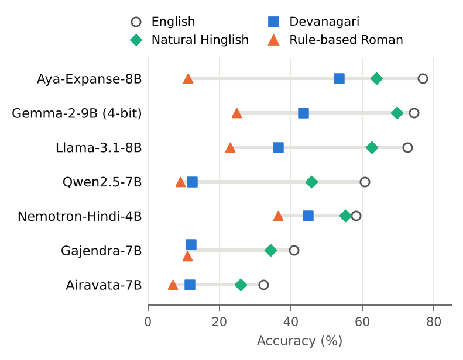

# ScriptConsist

**Do language models know the same facts when a Hindi speaker asks in English, in Devanagari, or in Hinglish?**

ScriptConsist asks the same 296 factual questions in four parallel forms:

| Form | Example |
|---|---|
| English | When did George Orwell die? |
| Hindi, Devanagari | जॉर्ज ऑरवेल की मृत्यु कब हुई थी? |
| Rule-based Roman (same words, Roman script) | Jorj orvel ki mrityu kab hui thi? |
| Natural Hinglish (typed by a native speaker) | George Orwell kab mare the? |

Devanagari vs. rule-based Roman changes only the **script**. Rule-based Roman vs. natural Hinglish changes only the **wording**, within the same script. Together they separate the two effects.

**[Live demo](https://aadeesh-01.github.io/ScriptConsist/)**: browse every question and every model's answer · **[Paper](paper/main.pdf)** · **[All result tables](results/analysis/summary.md)**

*Threws Odyssey 2026, Applied Research. Aadeesh Surana, IIIT Vadodara.*

## Main results

Accuracy (%) on 296 questions, averaged over three prompt wordings ([95% CIs](results/analysis/summary.md)):

| Model | English | Devanagari | Rule-based Roman | Natural Hinglish |
|---|---|---|---|---|
| Aya-Expanse-8B | 76.8 | 53.4 | 11.2 | 64.0 |
| Gemma-2-9B (4-bit) | 74.4 | 43.5 | 24.8 | 69.6 |
| Llama-3.1-8B | 72.5 | 36.4 | 23.0 | 62.6 |
| Qwen2.5-7B | 60.7 | 12.4 | 9.1 | 45.7 |
| Nemotron-Hindi-4B | 58.2 | 44.8 | 36.4 | 55.3 |
| Gajendra-7B | 40.8 | 12.0 | 11.0 | 34.2 |
| Airavata-7B | 32.3 | 11.7 | 6.9 | 25.9 |

- **Natural Hinglish beats Devanagari for every model**, by 10–33 points (all significant after Holm correction), and comes within 3–15 points of English.
- **Rule-based romanization is the worst form for every model.** Changing the script alone costs 1 to 42 points, depending on the model.
- **The automatic scorer agrees with blind human judgments** at Cohen's κ = 0.95 (331 answers across all forms). The main gap holds after correcting for scorer error ([validation report](results/validation/validation_report.md)).
- Results are stable across 4-bit quantization and prompt wording. A second person's Hinglish gives the same average accuracy for six of seven models (Airavata does 11 points better on the author's version).



## Repository layout

```
ScriptConsist/
├── README.md
├── requirements.txt
├── data/
│   ├── scriptconsist_v1.jsonl        ← THE BENCHMARK (296 questions, 4 forms each)
│   ├── annotations/                  human annotation records
│   │   ├── annotations_final.jsonl         Hinglish typing + answer checks
│   │   ├── annotations_round1_snapshot_*.jsonl   earlier round, kept for provenance
│   │   └── spelling_variation_pairs.json   73 questions typed by two people
│   ├── build/                        intermediate files and every keep/drop decision
│   │   ├── scriptconsist_iq.jsonl, scriptconsist_mk.jsonl, scriptconsist_mk_v1.jsonl
│   │   └── *_filtering.csv, *_review.csv    why each source question was kept or dropped
│   └── raw/                          untouched source datasets
│       ├── indicquest/  (L3Cube-IndicQuest, CC BY-NC-SA 4.0)
│       └── mintaka/     (Amazon Mintaka, CC BY 4.0)
├── code/
│   ├── build_from_indicquest.py      1. filter IndicQuest
│   ├── build_from_mintaka.py         2. filter + sample Mintaka
│   ├── finalize_mintaka.py           3. apply annotation and review decisions
│   ├── freeze_v1.py                  4. write data/scriptconsist_v1.jsonl
│   ├── validate_dataset.py           checks every item against the protocol rules
│   ├── romanize.py                   rule-based Devanagari → Roman transliteration
│   ├── prompts.py                    question forms × 3 prompt wordings
│   ├── run_generation.py             5. run a model (Hugging Face; fp16 / 4-bit)
│   ├── score.py                      6. cross-script answer scoring
│   └── analyze.py                    7. tables, confidence intervals, significance tests
├── notebooks/
│   ├── kaggle_scriptconsist.ipynb    runs all main models on Kaggle (2× T4)
│   └── kaggle_indic_models.ipynb     runs the Hindi/Hinglish models (Gajendra, Airavata)
├── results/
│   ├── generations/                  raw model answers, one file per model run
│   ├── scored/                       the same answers with correct/incorrect + rule used
│   ├── analysis/summary.md           ← ALL RESULT TABLES
│   └── validation/                   blind human check of the scorer
├── tests/test_score.py               68 scorer test cases
├── LICENSE                           MIT (code); data is CC BY-NC-SA 4.0, see data/README.md
├── annotation/index.html             phone-friendly annotation and validation page
├── docs/PROTOCOL.md                  every design decision, filter and limitation
├── paper/                            the paper: main.tex (XeLaTeX, ACL style), references.bib, figures/
├── demo/                             the explorer page: template.html + built explorer.html
├── docs/index.html                   the same page for GitHub Pages
└── archive/                          early drafts, kept for history; not used
```

## Reproduce

```bash
pip install -r requirements.txt

# dataset (deterministic; reproduces data/scriptconsist_v1.jsonl exactly)
python code/build_from_indicquest.py
python code/build_from_mintaka.py
python code/finalize_mintaka.py
python code/freeze_v1.py
python code/validate_dataset.py data/build/scriptconsist_mk.jsonl

# models (GPU; see notebooks/ for Kaggle)
python code/run_generation.py --model Qwen/Qwen2.5-7B-Instruct --precision fp16

# scoring and analysis
python code/score.py results/generations/*.jsonl
python code/analyze.py            # -> results/analysis/summary.md
python code/analyze_validation.py # -> results/validation/validation_report.md
python code/make_figures.py       # -> paper/figures/
python code/build_demo.py         # -> demo/explorer.html, docs/index.html
python tests/test_score.py

# paper (needs XeLaTeX and the FreeSerif font for Devanagari)
cd paper && latexmk -xelatex main.tex
```

## Models evaluated

Qwen2.5-7B-Instruct, Llama-3.1-8B-Instruct, Aya-Expanse-8B, Nemotron-4-Mini-Hindi-4B, Gemma-2-9B (4-bit), Airavata-7B,
Gajendra-7B, plus 4-bit versions of Qwen and Llama for the quantization comparison.

## Status (27 Oct 2026)

- [x] Dataset v1 frozen (296 questions)
- [x] 9 model runs complete (Gajendra re-run with its correct ChatML format; the invalid Tulu-format run is in `archive/`)
- [x] Blind human validation of the scorer: 340 answers + 48 repeats, κ = 0.95 (`results/validation/validation_report.md`)
- [x] Paper draft (`paper/main.pdf`)
- [x] Demo with real results (`docs/index.html`)

### Publishing the demo
On GitHub: Settings → Pages → Source: *Deploy from a branch*, Branch: `main`, folder `/docs`. The page appears at `https://<user>.github.io/ScriptConsist/`.

## Licences

Code: MIT. Data derived from IndicQuest is CC BY-NC-SA 4.0; data derived from Mintaka is CC BY 4.0. ScriptConsist as a whole is released under **CC BY-NC-SA 4.0** to respect both.
